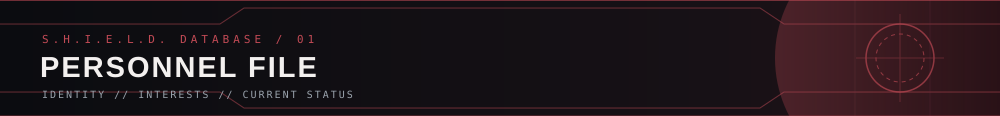
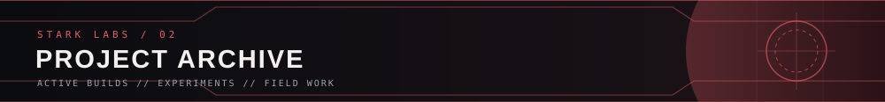
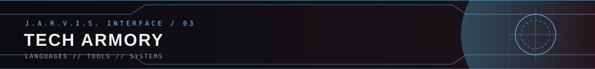
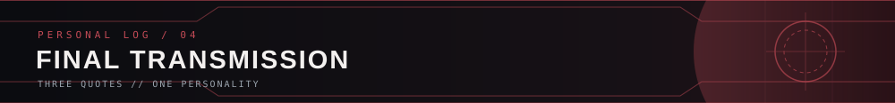

  

“Sometimes you gotta run before you can walk.” — Tony Stark

 

<table>
<tr>
<td width="58%" valign="top">

### Hey, I'm Laiba.

Computer Science undergraduate at NED who enjoys figuring out how things work and turning that curiosity into projects.

- 🎓 CS @ NED University
- 🧠 Interested in software development & AI/ML
- 🧩 Learning by building, one project at a time
- ⚙️ Currently working on **CrawlScope**

</td>
<td width="42%" valign="top">

<pre>
╭─ SYSTEM PROFILE ──────────╮
│ USER      Laiba Akram    │
│ STATUS    Learning       │
│ FOCUS     Software / ML  │
│ BASE      Karachi, PK    │
╰───────────────────────────╯
</pre>

“I can do this all day.” — Steve Rogers

</td>
</tr>
</table>

 

<table>
<tr>
<td width="50%" valign="top">

### CrawlScope

A web crawler in progress. Exploring crawler architecture, URL handling, and how the web can be traversed programmatically.

PYTHON · UNDER DEVELOPMENT

</td>
<td width="50%" valign="top">

### AirLab

PM2.5 forecasting and air-quality insights focused on Pakistan, developed as a collaborative machine-learning project.

ML · DATA · FORECASTING

</td>
</tr>
<tr>
<td width="50%" valign="top">

### [FileZipper](https://github.com/ilaybaakram/FileZipper)

A C++17 and Qt 6 desktop app for lossless file compression and decompression, implemented from scratch using Huffman Coding.

C++ · QT 6 · HUFFMAN CODING

</td>
<td width="50%" valign="top">

### More in the works

Building, experimenting, and adding new projects as I learn.

STAY TUNED

</td>
</tr>
</table>

 

 

ALWAYS ADDING TO THE ARMORY

 

<blockquote>

*“We're in the endgame now.”*

— Doctor Strange

</blockquote>

ONE STEP AT A TIME · ALWAYS BUILDING WHAT'S NEXT · KEEP THE CURIOSITY

 

