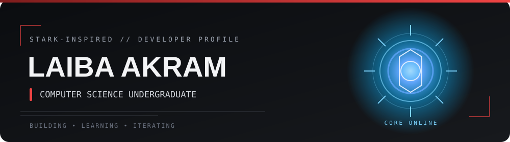

 

  

*“Sometimes you gotta run before you can walk.”*  
— Tony Stark

---

<table>
<tr>
<td width="52%" valign="top">

### ◈ ABOUT ME

Hey, I'm **Laiba** — a CS undergraduate who likes understanding how things work, then turning that curiosity into projects.

- 🎓 Computer Science @ NED
- 💻 Exploring software development & AI/ML
- 🧩 Learning through hands-on projects
- 🛠️ Currently building **CrawlScope**

</td>
<td width="48%" valign="top">

### ◈ SYSTEM PROFILE

<pre>
USER       Laiba Akram
STATUS     Learning / Building
INTERESTS  Software · AI/ML
LOCATION   Karachi, Pakistan
</pre>

*“I can do this all day.”*  
— Steve Rogers

</td>
</tr>
</table>

## ◈ PROJECT FILES

<table>
<tr>
<td width="50%" valign="top">

### [CrawlScope](https://github.com/ilaybaakram)

A web crawler in progress. Exploring crawling architecture, URL handling, and how the web can be traversed programmatically.

PYTHON · LEARNING IN PUBLIC

</td>
<td width="50%" valign="top">

### AirLab

PM2.5 forecasting and air-quality insights focused on Pakistan, built as a collaborative ML project.

ML · DATA · FORECASTING

</td>
</tr>
</table>

## ◈ TECH STACK

---

*“We're in the endgame now.”*  
— Doctor Strange

 

STARK-INSPIRED, NOT STARK-OVERLOADED. ✦

